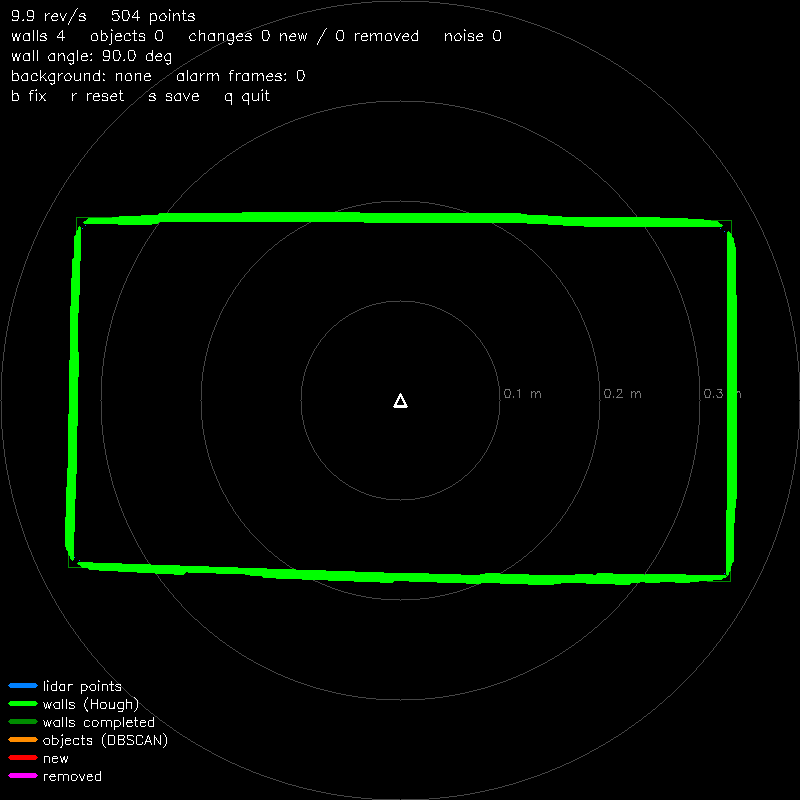
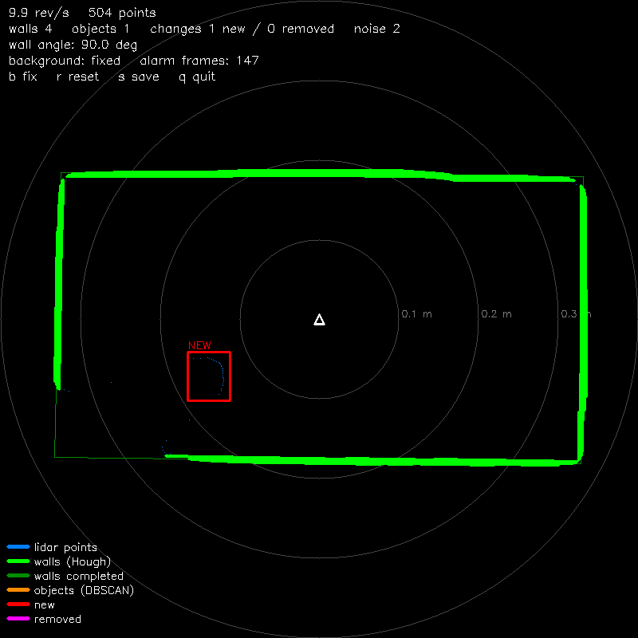
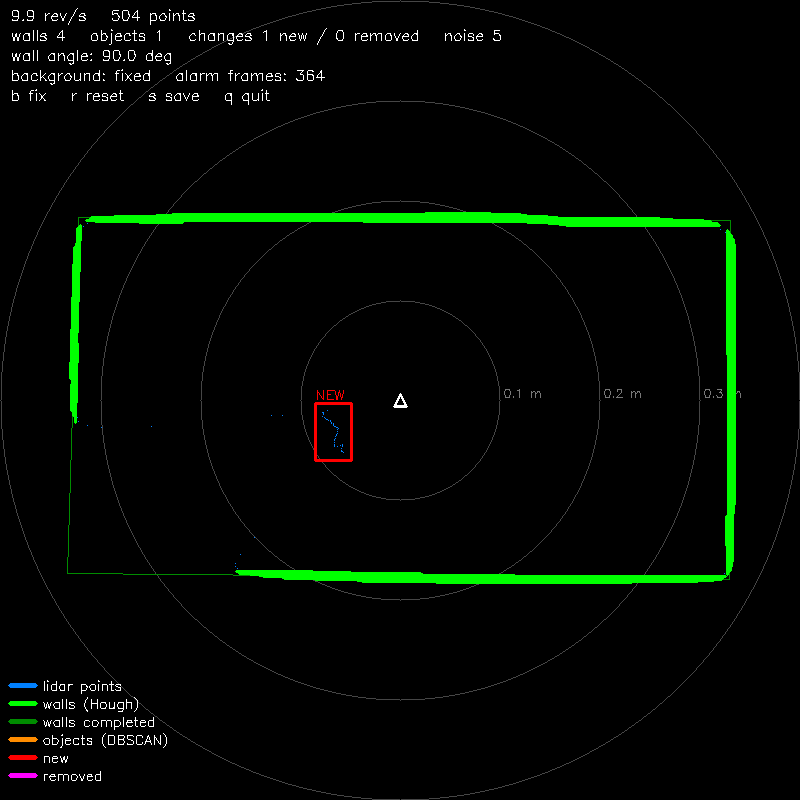
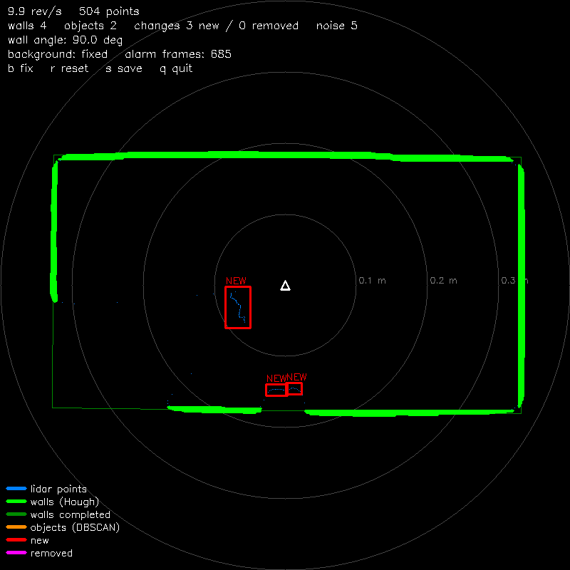
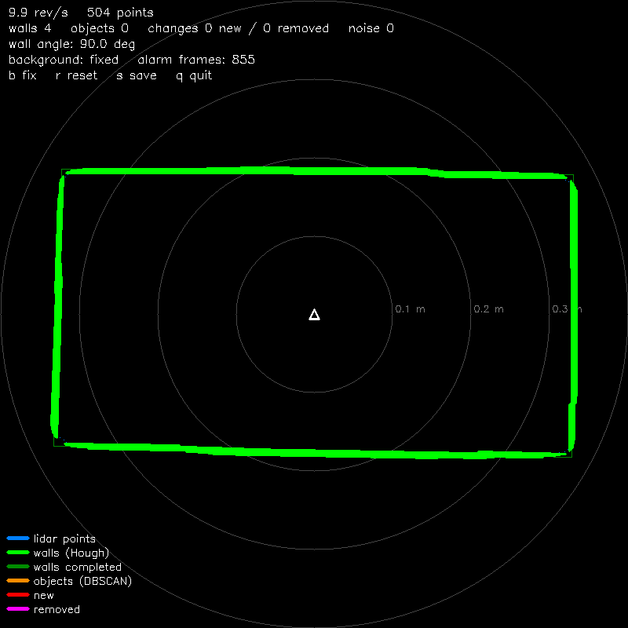
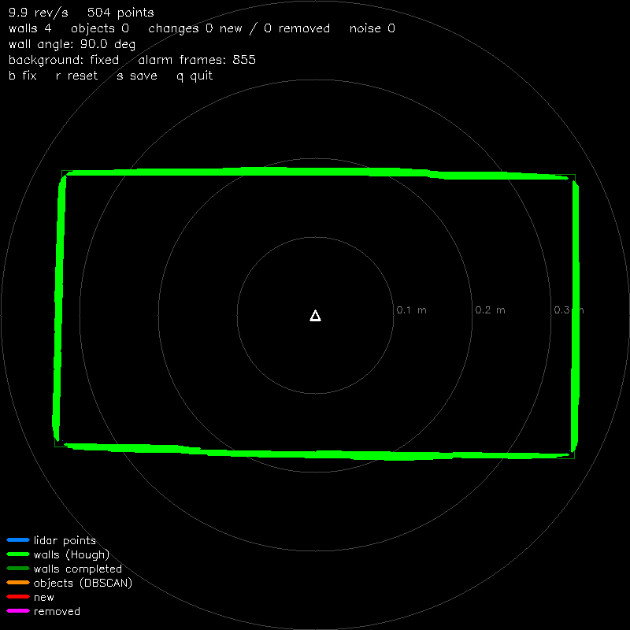
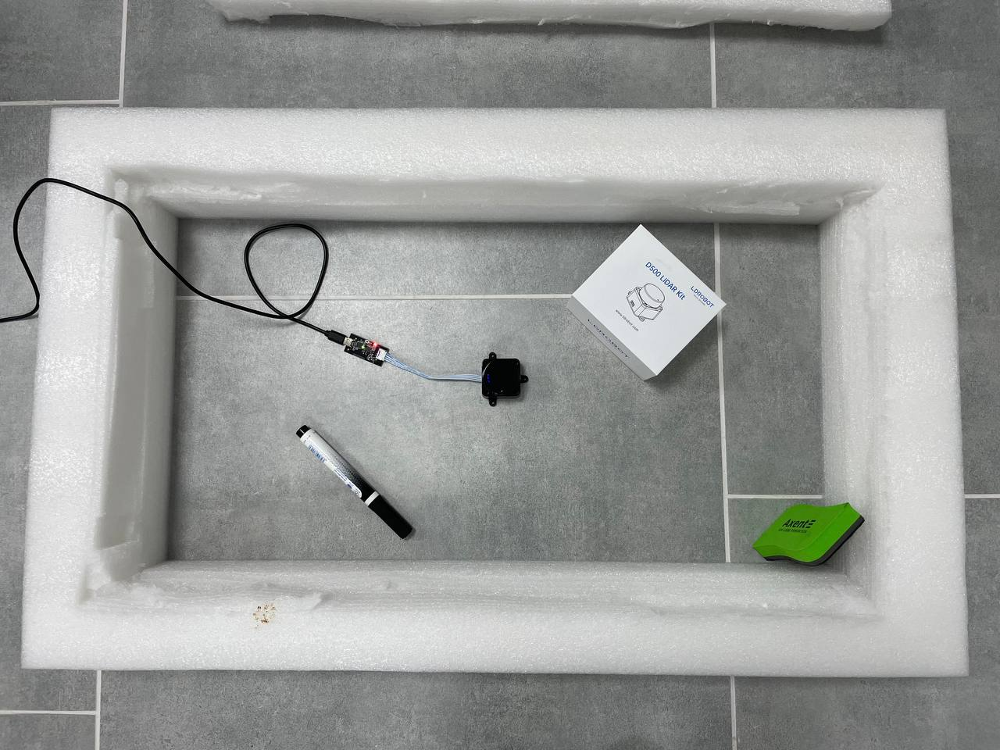

# LiDAR D500 — виявлення об'єктів та змін сцени

## Автор роботи

[Кристич Анна]

## Опис проєкту

Проєкт присвячений розробці застосунку для отримання та обробки даних LiDAR D500. Програма відображає сканування коробки в реальному часі, визначає її стінки, групує точки об'єктів та виявляє зміни у сцені відносно фонового сканування.

## Структура репозиторію

- `lidar_reader.py` — зчитування даних LiDAR та їх запис у CSV-файли (етап 1).
- `lidar_app.py` — основний застосунок для сканування та візуалізації даних у реальному часі, виявлення стінок, об'єктів і змін сцени.
- `lidar_analysis.ipynb` — аналіз записаних даних та експерименти з обробкою сканувань.
- `data/` — CSV-файли, отримані на етапах 1 і 6.
- `screenshots/` — скриншоти результатів експериментів етапу 6.
- `images/` — фотографії експериментальної установки.

## Запуск програми

Для роботи потрібен Python 3 та підключений LiDAR D500.

Встановлення бібліотек:

```bash
pip install numpy pandas opencv-python pyserial scikit-learn scipy matplotlib
```

Запуск основного застосунку:

```bash
python3 lidar_app.py
```

Перед запуском потрібно перевірити шлях до послідовного порту LiDAR у налаштуваннях програми.

Керування програмою:
- `b` — запис фонового сканування;
- `r` — скидання фонового сканування;
- `s` — збереження скриншота та поточного сканування;
- `q` — вихід із програми.

## Виконані етапи

**Етап 1. Збір даних.** Реалізовано зчитування даних LiDAR та запис 20 обертів для порожньої коробки й коробки з предметами. Дані збережено у CSV-файлах.

**Етап 2. Сканування в реальному часі.** Реалізовано читання даних у фоновому потоці та передачу повних обертів для подальшої обробки. Додано перетворення полярних координат у декартові.

**Етап 3. Виявлення стінок.** Для пошуку стінок коробки використано OpenCV, морфологічне розширення та перетворення Гафа HoughLinesP.

**Етап 4. Кластеризація об'єктів.** Для групування точок використано алгоритм DBSCAN. За результатами експериментів обрано `eps = 0.01 м` та `min_samples = 3`.

**Етап 5. Виявлення змін.** Реалізовано запис фонового сканування за 10 обертами та обчислення середнього значення відстані й стандартного відхилення. Для визначення змін використовується z-оцінка.

**Етап 6. Перевірка роботи.** Перевірено реакцію програми на додавання, переміщення та видалення предметів, а також на відсутність змін у сцені протягом 30 секунд.

## Результати етапу 6

| Що зробили | Що показав застосунок |
|---|---|
| Порожня коробка |  |
| Додали предмет у коробку |  |
| Перемістили предмет |  |
| Розмістили другий предмет біля стінки |  |
| Прибрали предмети з коробки |  |
| Залишили сцену без змін на 30 секунд |  |

## Фотографії експериментальної установки



## Висновки

У результаті роботи реалізовано застосунок для отримання та візуалізації даних LiDAR D500, визначення стінок коробки, кластеризації об'єктів і виявлення змін у сцені.

Під час експериментів встановлено, що результати залежать від відстані до предметів, їхнього розташування та параметрів кластеризації. Можливі пропуски точок і хибні спрацювання поблизу стінок.
